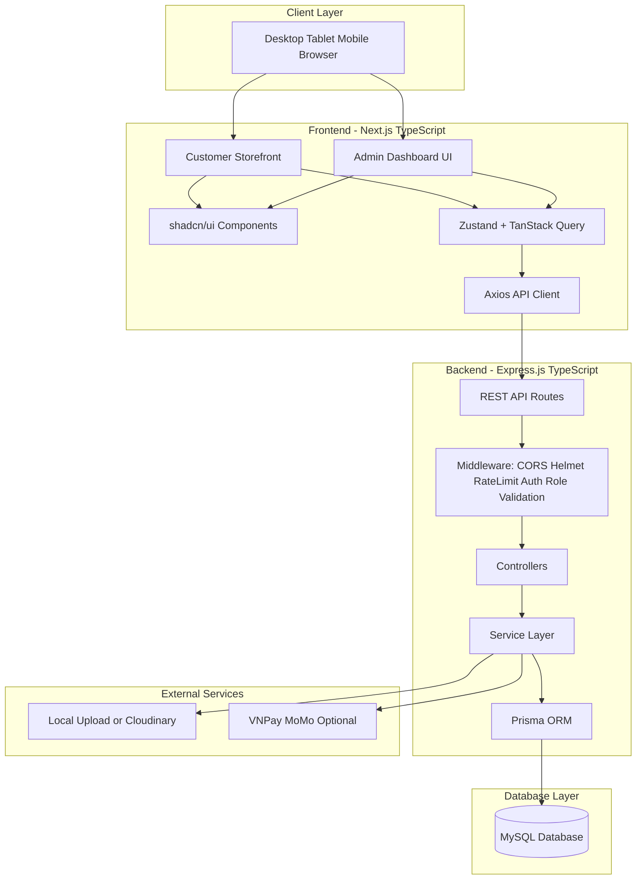

# PHASE 1 - SYSTEM ANALYSIS

## 1. Phan Tich Yeu Cau Website

De tai: **Xay dung website thuong mai dien tu ban quan ao F1**.

He thong can dap ung nhu cau mua sam truc tuyen cua khach hang va nhu cau quan tri cua nhan vien/admin. San pham trong he thong la cac mat hang thoi trang lien quan den Formula 1 nhu ao Ferrari, ao Red Bull Racing, hoodie, jacket, mu, phu kien va cac bo suu tap theo doi dua.

Website can co hai khu vuc chinh:

- **Customer Website**: khach hang xem san pham, tim kiem, loc, xem chi tiet bien the, them gio hang, dat hang, quan ly don hang, danh gia va yeu thich san pham.
- **Admin Dashboard**: admin quan ly nguoi dung, danh muc, thuong hieu/F1 team, san pham, bien the, ton kho, don hang, coupon, review va thong ke kinh doanh.

Trong do, nghiep vu quan trong nhat la **quan ly ton kho theo tung bien the san pham**. Moi san pham quan ao co the co nhieu mau va size. Moi combination mau/size la mot `ProductVariant` rieng, co SKU, gia, gia sale va so luong ton kho rieng. Khi khach hang chon mau va size, he thong phai hien thi dung stock cua bien the do va khong cho dat vuot qua ton kho.

Flow demo chinh can dam bao:

1. Khach hang vao trang chu.
2. Xem san pham Ferrari.
3. Chon mau Red va size M.
4. He thong hien thi ton kho la 10.
5. Them 2 san pham vao gio hang.
6. Checkout.
7. Don hang duoc tao.
8. Stock Red/M giam tu 10 xuong 8.
9. Admin dang nhap.
10. Admin xem don hang moi.
11. Admin cap nhat trang thai don hang tu `PENDING` sang `CONFIRMED`, `SHIPPING`, `DELIVERED`.
12. Dashboard cap nhat doanh thu.
13. Admin xem lich su ton kho co transaction `SALE -2`, `10 -> 8`.

## 2. Actor

### Guest

Nguoi dung chua dang nhap.

- Xem trang chu.
- Xem danh sach san pham.
- Tim kiem va loc san pham.
- Xem chi tiet san pham.
- Them san pham vao gio hang localStorage.
- Dang ky tai khoan.
- Dang nhap.

### Customer

Nguoi dung da dang nhap voi role `CUSTOMER`.

- Thuc hien tat ca chuc nang cua Guest.
- Quan ly thong tin ca nhan.
- Quan ly dia chi giao hang.
- Them/xoa san pham yeu thich.
- Them/sua/xoa gio hang.
- Ap dung coupon.
- Checkout va tao don hang.
- Xem lich su don hang.
- Xem chi tiet don hang.
- Huy don hang neu trang thai cho phep.
- Danh gia san pham da mua.

### Admin

Nguoi quan tri he thong voi role `ADMIN`.

- Dang nhap trang Admin Dashboard.
- Xem dashboard thong ke.
- Quan ly user.
- Quan ly category.
- Quan ly brand/F1 team.
- Quan ly product.
- Quan ly product variant.
- Quan ly size va color.
- Quan ly ton kho va lich su inventory transaction.
- Quan ly don hang va cap nhat trang thai.
- Quan ly coupon.
- Quan ly review.

### Payment Provider

Tac nhan mo rong trong tuong lai neu tich hop VNPay/MoMo.

- Nhan yeu cau thanh toan.
- Tra ve ket qua thanh toan.
- Cap nhat payment status.

## 3. Functional Requirements

### 3.1 Authentication

- Guest co the dang ky tai khoan bang email, mat khau va thong tin co ban.
- He thong validate email hop le, password toi thieu 8 ky tu.
- Password phai duoc hash bang bcrypt.
- Customer/Admin co the dang nhap bang email va password.
- Sau khi dang nhap, he thong tra ve access token va refresh token.
- Access token co thoi han ngan.
- Refresh token duoc luu trong database de ho tro cap token moi.
- User co the logout, refresh token phai bi vo hieu hoa.
- API `GET /api/auth/me` tra ve thong tin user hien tai, khong bao gio tra password.
- API admin phai duoc bao ve bang middleware `authenticate` va `authorize("ADMIN")`.

### 3.2 Customer Homepage

- Hien thi header gom logo, menu, search, login/register, wishlist va cart.
- Hien thi hero banner theo phong cach F1 fashion premium.
- Hien thi danh muc noi bat.
- Hien thi san pham moi.
- Hien thi san pham ban chay.
- Hien thi san pham giam gia.
- Hien thi bo suu tap noi bat.
- Hien thi banner quang cao.
- Hien thi newsletter va footer.
- Giao dien responsive tren desktop, tablet va mobile.

### 3.3 Product Listing

- Hien thi danh sach san pham dang grid.
- Ho tro pagination.
- Ho tro tim kiem theo ten san pham, SKU, brand va category.
- Ho tro loc theo category.
- Ho tro loc theo brand.
- Ho tro loc theo khoang gia.
- Ho tro loc theo size.
- Ho tro loc theo color.
- Ho tro loc san pham con hang.
- Ho tro sap xep theo gia tang dan, gia giam dan, moi nhat, ban chay va rating.
- Product card hien thi anh, ten, gia goc, gia sale, phan tram giam gia, mau, trang thai ton kho, rating va wishlist.

### 3.4 Product Detail

- Hien thi gallery nhieu anh san pham.
- Ho tro zoom anh neu phu hop.
- Hien thi ten san pham, brand, category, mo ta, gia va gia khuyen mai.
- Hien thi danh sach mau va size co san.
- Khi user chon mau va size, he thong lay dung `ProductVariant`.
- Hien thi stock cua bien the dang chon.
- Khong cho them vao gio hang neu bien the het hang.
- Khong cho chon so luong vuot qua stock.
- Co nut Add to Cart, Buy Now va Wishlist.
- Hien thi rating trung binh, tong review va danh sach review.
- Hien thi san pham lien quan.

### 3.5 Cart

- Guest co the luu cart bang localStorage.
- Customer co the luu cart tren database.
- Khi login co the dong bo cart local voi cart database neu trien khai.
- Cart item luu product variant, size, color, so luong va gia hien tai de hien thi.
- Cho phep tang/giam so luong.
- Cho phep xoa item.
- Khong cho so luong vuot qua stock.
- Hien thi subtotal, discount, shipping va total.

### 3.6 Checkout

- Customer nhap thong tin nguoi nhan: ho ten, so dien thoai, email, tinh/thanh, quan/huyen, phuong/xa, dia chi chi tiet va ghi chu.
- Customer co the chon dia chi da luu.
- Hien thi order summary.
- Cho phep nhap coupon code.
- Ho tro thanh toan COD.
- Co the mo rong thanh toan VNPay/MoMo.
- Backend phai validate lai coupon.
- Backend phai kiem tra stock lan cuoi bang transaction.
- Neu stock khong du, khong tao don va tra loi ro bien the nao khong du.

### 3.7 Orders

- Tao don hang thanh cong khi stock du va du lieu checkout hop le.
- Order co status: `PENDING`, `CONFIRMED`, `PROCESSING`, `SHIPPING`, `DELIVERED`, `CANCELLED`.
- Payment co status: `UNPAID`, `PAID`, `REFUNDED`.
- Customer xem danh sach don hang cua minh.
- Customer xem chi tiet don hang.
- Customer co the huy don neu don hang dang o trang thai cho phep.
- OrderItem phai snapshot thong tin tai thoi diem mua: productName, sku, size, color, unitPrice, quantity, subtotal.

### 3.8 Inventory

- Quan ly stock theo tung `ProductVariant`.
- Admin co the them stock, giam stock hoac chinh truc tiep stock.
- He thong hien thi bien the het hang va sap het hang.
- Low Stock khi stock <= 5.
- Out of Stock khi stock = 0.
- Khi tao don thanh cong theo business rule, stock bi tru.
- Khi don bi huy va truoc do da tru stock, stock phai duoc hoan.
- Moi thay doi stock phai tao `InventoryTransaction`.
- Khong bao gio cho stock am.

### 3.9 Admin Dashboard

- Hien thi tong doanh thu.
- Hien thi tong don hang.
- Hien thi tong khach hang.
- Hien thi tong san pham.
- Hien thi so san pham het hang.
- Hien thi so san pham sap het hang.
- Bieu do doanh thu theo thang.
- Bieu do so luong don hang theo thang.
- Bieu do trang thai don hang.
- Bieu do top san pham ban chay.
- Bieu do top category ban chay.
- Loc thong ke theo hom nay, 7 ngay, 30 ngay, thang nay va nam nay.

### 3.10 Admin Product Management

- Admin xem danh sach san pham dang table.
- Table co image, name, category, brand, base price, variants, total stock, status, createdAt va actions.
- Ho tro pagination, search, filter va sort.
- Admin tao/sua/xoa san pham.
- Product co name, slug, short description, long description, category, brand, price, salePrice, main image, gallery images, status va featured.
- Admin them/sua/xoa variant cho san pham.
- Moi variant co color, size, SKU, stock, price va salePrice.
- SKU phai unique.

### 3.11 Category Management

- Admin CRUD category.
- Category co name, slug, description, image va isActive.
- Slug category phai unique.
- Khong hard-code category trong frontend.

### 3.12 Brand/F1 Team Management

- Admin CRUD brand.
- Brand co name, slug, logo, description va isActive.
- Cac doi F1 nhu Ferrari, Red Bull Racing, Mercedes-AMG Petronas, McLaren, Aston Martin, Alpine, Williams duoc tao bang seed data.
- Khong hard-code brand trong frontend.

### 3.13 Review

- Customer dang nhap co the danh gia san pham.
- Review gom rating 1-5 sao va comment.
- Neu co the, chi user da mua san pham moi duoc review.
- Product detail hien thi rating trung binh, tong review va danh sach review.
- Admin co the xem, an hoac xoa review.

### 3.14 Coupon

- Admin tao/sua/xoa coupon.
- Coupon co code, type, value, minOrderValue, maxDiscount, startDate, endDate, usageLimit, usedCount va isActive.
- Type gom `PERCENT` va `FIXED`.
- Backend validate coupon: active, con han, chua vuot usage limit, dat min order value.
- Frontend khong duoc tu tinh discount lam du lieu tin cay.

### 3.15 Favorites

- Customer co the them san pham vao danh sach yeu thich.
- Customer co the xoa san pham khoi danh sach yeu thich.
- Wishlist hien thi danh sach san pham da luu.

### 3.16 Address Management

- Customer co the them/sua/xoa dia chi.
- Customer co the dat mot dia chi mac dinh.
- Checkout co the chon dia chi da luu.

### 3.17 Search

- Search theo product name, SKU, brand va category.
- Frontend co debounce de giam so request.
- Co the mo rong suggestion dropdown.

### 3.18 Documentation And Demo Support

- Co README huong dan cai dat, cau hinh, migrate, seed va chay du an.
- Co tai lieu do an gom mo ta de tai, use case, ERD, activity diagram, sequence diagram, architecture, API design, testing va security.
- Co seed data phuc vu demo.

## 4. Non-functional Requirements

### Performance

- Trang danh sach san pham phai co pagination.
- Search va filter phai duoc index hop ly o database.
- Frontend can co skeleton loading va debounce search.
- API phai tra response nhanh voi du lieu demo.

### Security

- Password hash bang bcrypt.
- JWT access token co expiration.
- Refresh token duoc luu va thu hoi an toan.
- API admin bat buoc kiem tra role.
- Ap dung Helmet, CORS, rate limiting va validation.
- Khong tra ve password hoac token nhay cam khong can thiet.
- Khong tin du lieu tu frontend.
- Su dung Prisma ORM de giam rui ro SQL Injection.
- Validate va sanitize input de giam rui ro XSS.
- Thong tin nhay cam nam trong `.env`, khong commit len GitHub.

### Reliability

- Xu ly order va inventory bang database transaction.
- Neu mot buoc trong checkout loi, rollback toan bo.
- Khong cho stock am trong moi tinh huong.
- Luu inventory transaction de truy vet thay doi ton kho.

### Maintainability

- Backend chia module ro rang.
- Controller chi xu ly request/response, logic nghiep vu nam trong service.
- Co DTO/validator cho input.
- Response format thong nhat.
- Code co TypeScript type ro rang.
- Ten bien va ten file de hieu.

### Scalability

- Kien truc REST API cho phep tach frontend/backend.
- Co the mo rong thanh toan online, shipping provider, notification, email service.
- Database co index va quan he ro rang.
- Product variant tach rieng giup mo rong nhieu size/mau.

### Usability

- UI hien dai, responsive tot.
- Co empty state, error state, loading state, toast va confirm dialog.
- Admin UI co sidebar, breadcrumb, table va form ro rang.
- Flow mua hang ngan gon, de demo.

### Compatibility

- Ho tro desktop, tablet va mobile.
- Ho tro cac trinh duyet hien dai.

### SEO

- Neu dung Next.js, ho tro metadata, title, description, OpenGraph, slug than thien, sitemap va robots.txt.

## 5. Business Rules

1. Email user phai unique.
2. Product slug phai unique.
3. Category slug phai unique.
4. Brand slug phai unique.
5. SKU cua `ProductVariant` phai unique.
6. Product quan ao bat buoc co bien the size/mau de ban hang.
7. Moi combination product/color/size nen chi co mot variant active.
8. Khong cho them vao cart so luong lon hon stock hien tai.
9. Frontend chi hien thi stock; Backend moi la noi quyet dinh cuoi cung.
10. Khi checkout, Backend phai kiem tra lai stock trong transaction.
11. Khong cho tao don hang neu bat ky item nao khong du stock.
12. Stock khong duoc am.
13. Khi tao order thanh cong theo business rule, stock cua variant phai giam.
14. Khi stock thay doi do ban hang, phai tao inventory transaction type `SALE`.
15. Khi don hang bi huy va truoc do da tru stock, phai hoan stock va tao transaction `CANCEL_RETURN`.
16. Khi admin chinh ton kho thu cong, phai tao transaction `MANUAL_ADJUSTMENT`.
17. Khi admin nhap hang, phai tao transaction `IMPORT`.
18. OrderItem phai snapshot productName, sku, size, color, unitPrice, quantity va subtotal.
19. Khi xem lai don cu, khong tinh lai gia tu Product/Variant hien tai.
20. Coupon phai duoc validate o Backend.
21. Coupon het han, inactive, vuot usageLimit hoac khong dat minOrderValue se khong hop le.
22. Discount khong duoc vuot `maxDiscount` neu coupon type la `PERCENT`.
23. Customer chi duoc xem don hang cua chinh minh.
24. Customer chi duoc huy don o trang thai cho phep, vi du `PENDING` hoac `CONFIRMED` tuy business rule.
25. Admin moi duoc truy cap API `/api/admin/*`.
26. Password khong bao gio duoc tra ve frontend.
27. Review nen chi cho phep khi user da mua san pham va don hang da `DELIVERED`.
28. Low Stock khi stock <= 5.
29. Out of Stock khi stock = 0.
30. Khong hard-code admin, brand, category trong frontend.

## 6. Tech Stack De Xuat Cuoi Cung

### Frontend

- **Next.js + React + TypeScript**: phu hop cho e-commerce, ho tro routing, SEO metadata, server rendering/static generation khi can.
- **Tailwind CSS**: tao UI nhanh, responsive tot, de dong bo design system.
- **shadcn/ui**: component hien dai, tuy bien cao, phu hop dashboard va form.
- **React Hook Form + Zod**: validate form tot, type-safe, dung lai schema validation ro rang.
- **Axios**: quan ly REST API client, interceptor token va error handling thuan tien.
- **Zustand**: quan ly cart, auth state, wishlist UI state gon nhe hon Redux.
- **TanStack Query**: quan ly server state, cache product list, admin tables va mutations tot hon viec tu quan ly loading/error thu cong.
- **Recharts**: ve chart dashboard nhanh va de demo.

### Backend

- **Node.js + Express.js + TypeScript**: de trien khai REST API ro rang, phu hop do an, de giai thich voi hoi dong.
- **Prisma ORM**: type-safe database access, migrate schema, seed data, transaction.
- **MySQL**: database quan he phu hop e-commerce, de cai dat va giai thich ERD.
- **Zod**: validate request body/query/params o backend.
- **bcrypt**: hash password.
- **jsonwebtoken**: JWT access token va refresh token.
- **Helmet, CORS, express-rate-limit**: tang bao mat API.
- **Multer + Cloudinary hoac local upload**: giai doan development co the luu local, sau do mo rong Cloudinary.
- **Swagger/OpenAPI**: tai lieu API cho demo va Postman.

### Ly do chon Express thay vi NestJS

NestJS manh ve architecture nhung co nhieu abstraction. Voi muc tieu do an tot nghiep can code ro rang, de giai thich va trien khai nhanh, Express + TypeScript + module/service/controller pattern la lua chon can bang hon. Kien truc van dam bao separation of concerns, validation, middleware, service layer va Prisma transaction.

## 7. System Architecture

He thong ap dung kien truc tach frontend/backend:

```text
Frontend Next.js
  -> REST API Client
  -> Backend Express API
  -> Middleware Layer
  -> Controller Layer
  -> Service Layer
  -> Prisma ORM
  -> MySQL Database
```

### Frontend Layers

- **Pages/App Router**: dinh nghia route customer va admin.
- **Components**: UI tai su dung nhu ProductCard, Header, DataTable, Form, Modal.
- **Services**: goi API thong qua Axios.
- **Stores**: quan ly auth, cart, wishlist local state.
- **Hooks**: dong goi logic goi API, debounce, filter state.
- **Types**: TypeScript interface/type dung chung frontend.
- **Utils**: dinh dang tien te, tao slug, tinh discount, format date.

### Backend Layers

- **Routes**: khai bao endpoint REST.
- **Controllers**: nhan request, goi service, tra response.
- **Services**: xu ly business logic.
- **Validators/DTO**: validate input bang Zod.
- **Middleware**: authenticate, authorize, error handler, rate limit.
- **Prisma**: truy van database va transaction.
- **Utils**: token, password, response format, pagination.

### Response Format

Thanh cong:

```json
{
  "success": true,
  "message": "Success",
  "data": {}
}
```

That bai:

```json
{
  "success": false,
  "message": "Validation failed",
  "errors": []
}
```

## 8. Cau Truc Source Code De Xuat

```text
f1-fashion-store/
  frontend/
    src/
      app/
        (store)/
          page.tsx
          products/
          cart/
          checkout/
          account/
        admin/
          page.tsx
          products/
          categories/
          brands/
          inventory/
          orders/
          customers/
          reviews/
          coupons/
      components/
        common/
        layout/
        product/
        cart/
        checkout/
        admin/
        ui/
      hooks/
      services/
        api.ts
        auth.service.ts
        product.service.ts
        cart.service.ts
        order.service.ts
        admin.service.ts
      stores/
        auth.store.ts
        cart.store.ts
        wishlist.store.ts
      types/
      utils/
      constants/
    public/
    package.json
    next.config.ts
    tailwind.config.ts
    .env.example

  backend/
    src/
      config/
        env.ts
        prisma.ts
      middleware/
        authenticate.ts
        authorize.ts
        error.middleware.ts
        validate.middleware.ts
      modules/
        auth/
          auth.controller.ts
          auth.routes.ts
          auth.service.ts
          auth.validator.ts
        users/
        products/
        categories/
        brands/
        variants/
        inventory/
        cart/
        orders/
        payments/
        reviews/
        coupons/
        favorites/
        addresses/
        dashboard/
      routes/
        index.ts
      utils/
        api-response.ts
        async-handler.ts
        jwt.ts
        password.ts
        pagination.ts
      app.ts
      server.ts
    prisma/
      schema.prisma
      seed.ts
    uploads/
    package.json
    tsconfig.json
    .env.example

  docs/
    PHASE_1_SYSTEM_ANALYSIS.md
    ERD.md
    API_DESIGN.md
    TEST_CASES.md
    GRADUATION_REPORT.md

  README.md
```

## 9. Database Entities Can Co

### User

Luu thong tin tai khoan khach hang/admin.

Thuoc tinh du kien: id, email, password, fullName, phone, avatar, role, isActive, createdAt, updatedAt.

Quan he:

- User co nhieu Address.
- User co mot Cart.
- User co nhieu Order.
- User co nhieu Review.
- User co nhieu Favorite.
- User co nhieu RefreshToken.
- User co the tao InventoryTransaction neu la admin.

### RefreshToken

Luu refresh token da cap.

Thuoc tinh du kien: id, userId, tokenHash, expiresAt, revokedAt, createdAt.

### Address

Luu dia chi giao hang cua customer.

Thuoc tinh du kien: id, userId, fullName, phone, province, district, ward, detail, isDefault, createdAt, updatedAt.

### Category

Luu danh muc san pham.

Thuoc tinh du kien: id, name, slug, description, image, isActive, createdAt, updatedAt.

### Brand

Luu brand/F1 team.

Thuoc tinh du kien: id, name, slug, logo, description, isActive, createdAt, updatedAt.

### Product

Luu thong tin san pham chinh.

Thuoc tinh du kien: id, categoryId, brandId, name, slug, shortDescription, description, basePrice, salePrice, mainImage, status, isFeatured, createdAt, updatedAt.

Quan he:

- Product thuoc Category.
- Product thuoc Brand.
- Product co nhieu ProductImage.
- Product co nhieu ProductVariant.
- Product co nhieu Review.
- Product co nhieu Favorite.

### ProductImage

Luu gallery anh san pham.

Thuoc tinh du kien: id, productId, url, alt, sortOrder, createdAt.

### Size

Luu size san pham.

Thuoc tinh du kien: id, name, slug, sortOrder, isActive.

### Color

Luu mau san pham.

Thuoc tinh du kien: id, name, slug, hexCode, isActive.

### ProductVariant

Luu bien the san pham theo size va color.

Thuoc tinh du kien: id, productId, sizeId, colorId, sku, stock, price, salePrice, isActive, createdAt, updatedAt.

Rang buoc:

- `sku` unique.
- Nen co unique composite `(productId, sizeId, colorId)`.
- `stock >= 0`.

### InventoryTransaction

Luu lich su thay doi ton kho.

Thuoc tinh du kien: id, productVariantId, type, quantity, previousStock, newStock, note, createdBy, createdAt.

Type: `IMPORT`, `SALE`, `CANCEL_RETURN`, `MANUAL_ADJUSTMENT`.

### Cart

Luu gio hang cua customer.

Thuoc tinh du kien: id, userId, createdAt, updatedAt.

### CartItem

Luu item trong gio hang.

Thuoc tinh du kien: id, cartId, productVariantId, quantity, createdAt, updatedAt.

Rang buoc:

- Unique `(cartId, productVariantId)` de tranh trung item.

### Favorite

Luu san pham yeu thich.

Thuoc tinh du kien: id, userId, productId, createdAt.

Rang buoc:

- Unique `(userId, productId)`.

### Order

Luu don hang.

Thuoc tinh du kien: id, userId, orderCode, status, paymentStatus, paymentMethod, receiverName, receiverPhone, receiverEmail, province, district, ward, addressDetail, note, subtotal, discount, shippingFee, total, couponId, createdAt, updatedAt.

Rang buoc:

- `orderCode` unique.

### OrderItem

Luu chi tiet don hang va snapshot du lieu tai thoi diem mua.

Thuoc tinh du kien: id, orderId, productVariantId, productName, sku, size, color, unitPrice, quantity, subtotal.

### Coupon

Luu ma giam gia.

Thuoc tinh du kien: id, code, type, value, minOrderValue, maxDiscount, startDate, endDate, usageLimit, usedCount, isActive, createdAt, updatedAt.

Rang buoc:

- `code` unique.

### Review

Luu danh gia san pham.

Thuoc tinh du kien: id, userId, productId, orderItemId, rating, comment, isVisible, createdAt, updatedAt.

Rang buoc:

- `rating` tu 1 den 5.
- Co the unique `(userId, orderItemId)` de moi item da mua chi review mot lan.

### Payment

Bang mo rong neu can luu giao dich online.

Thuoc tinh du kien: id, orderId, provider, transactionCode, amount, status, rawResponse, createdAt.

## 10. Mermaid Use Case Diagram

```mermaid
flowchart LR
  Guest([Guest])
  Customer([Customer])
  Admin([Admin])
  PaymentProvider([Payment Provider])

  subgraph Storefront[Customer Website]
    UC_ViewHome((View homepage))
    UC_Search((Search products))
    UC_Filter((Filter and sort products))
    UC_ViewProduct((View product detail))
    UC_Register((Register))
    UC_Login((Login))
    UC_ManageProfile((Manage profile))
    UC_ManageAddress((Manage addresses))
    UC_Favorite((Manage favorites))
    UC_Cart((Manage cart))
    UC_Checkout((Checkout))
    UC_ApplyCoupon((Apply coupon))
    UC_MyOrders((View my orders))
    UC_CancelOrder((Cancel order))
    UC_Review((Review purchased product))
  end

  subgraph AdminArea[Admin Dashboard]
    UC_AdminLogin((Admin login))
    UC_Dashboard((View dashboard analytics))
    UC_Users((Manage users))
    UC_Categories((Manage categories))
    UC_Brands((Manage brands))
    UC_Products((Manage products))
    UC_Variants((Manage variants))
    UC_Inventory((Manage inventory))
    UC_Orders((Manage orders))
    UC_Coupons((Manage coupons))
    UC_Reviews((Manage reviews))
  end

  subgraph Payment[Payment Integration]
    UC_PayCOD((Select COD))
    UC_PayOnline((Pay online))
    UC_PaymentCallback((Payment callback))
  end

  Guest --> UC_ViewHome
  Guest --> UC_Search
  Guest --> UC_Filter
  Guest --> UC_ViewProduct
  Guest --> UC_Register
  Guest --> UC_Login
  Guest --> UC_Cart

  Customer --> UC_ViewHome
  Customer --> UC_Search
  Customer --> UC_Filter
  Customer --> UC_ViewProduct
  Customer --> UC_ManageProfile
  Customer --> UC_ManageAddress
  Customer --> UC_Favorite
  Customer --> UC_Cart
  Customer --> UC_Checkout
  Customer --> UC_ApplyCoupon
  Customer --> UC_MyOrders
  Customer --> UC_CancelOrder
  Customer --> UC_Review

  Admin --> UC_AdminLogin
  Admin --> UC_Dashboard
  Admin --> UC_Users
  Admin --> UC_Categories
  Admin --> UC_Brands
  Admin --> UC_Products
  Admin --> UC_Variants
  Admin --> UC_Inventory
  Admin --> UC_Orders
  Admin --> UC_Coupons
  Admin --> UC_Reviews

  UC_Checkout --> UC_PayCOD
  UC_Checkout --> UC_PayOnline
  PaymentProvider --> UC_PaymentCallback
```



## 11. Mermaid Architecture Diagram



## 12. Roadmap Trien Khai

### Phase 1 - System Analysis

Muc tieu:

- Phan tich yeu cau.
- Xac dinh actor, functional requirements, non-functional requirements.
- Xac dinh business rules.
- Chon tech stack.
- De xuat architecture, source structure va entities.
- Tao use case diagram va architecture diagram.

Trang thai: **Hoan thanh trong tai lieu nay**.

### Phase 2 - Architecture And API Planning

Muc tieu:

- Chot module backend.
- Thiet ke REST API chi tiet.
- Chuan hoa response, error code va pagination format.
- Thiet ke auth flow, order flow va inventory flow.
- Chot strategy upload anh.

Ket qua:

- `docs/API_DESIGN.md`
- `docs/AUTH_FLOW.md`
- `docs/ORDER_INVENTORY_FLOW.md`

### Phase 3 - Database Design And ERD

Muc tieu:

- Thiet ke ERD chi tiet.
- Mo ta primary key, foreign key, index, unique constraint va cascade behavior.
- Viet Mermaid ERD.

Ket qua:

- `docs/ERD.md`
- Ban thiet ke database san sang chuyen sang Prisma.

### Phase 4 - Prisma Schema And Seed Plan

Muc tieu:

- Tao `backend/prisma/schema.prisma`.
- Tao enum, model, relation, index va unique constraint.
- Tao seed data cho admin, customer, brand, category, product, variant, coupon, order va review.

Ket qua:

- Prisma schema hoan chinh.
- Seed plan va seed script.

### Phase 5 - Backend Project Setup

Muc tieu:

- Khoi tao backend Express TypeScript.
- Cau hinh env, Prisma client, middleware, error handler, response helper.
- Cau hinh CORS, Helmet, rate limiting.

Ket qua:

- Backend chay duoc.
- Health check API.

### Phase 6 - Authentication

Muc tieu:

- Dang ky, dang nhap, refresh, logout, me.
- JWT access token, refresh token, bcrypt.
- Middleware authenticate va authorize.

Ket qua:

- Auth API hoan chinh.
- Bao ve duoc admin API.

### Phase 7 - Product, Category, Brand

Muc tieu:

- CRUD category va brand cho admin.
- Product listing va product detail cho customer.
- Product management cho admin.
- Search, filter, sort, pagination.

Ket qua:

- API product/category/brand hoat dong.

### Phase 8 - Product Variant And Inventory

Muc tieu:

- CRUD size, color, variant.
- Quan ly stock theo variant.
- Inventory transaction.
- Low stock/out of stock.

Ket qua:

- Demo duoc variant Ferrari Red/M stock 10.

### Phase 9 - Cart

Muc tieu:

- Guest cart bang localStorage tren frontend.
- Customer cart bang database.
- Add/update/remove item.
- Validate stock khi add/update.

Ket qua:

- Cart summary dung subtotal, discount, shipping, total.

### Phase 10 - Order And Checkout

Muc tieu:

- Checkout voi address, coupon va COD.
- Tao order bang database transaction.
- Tru stock va tao inventory transaction.
- Huy don va hoan stock khi hop le.

Ket qua:

- Flow demo stock 10 -> 8 chay on dinh.

### Phase 11 - Admin Dashboard

Muc tieu:

- API thong ke doanh thu, don hang, user, product, low stock.
- Chart doanh thu, don hang, status, top product, top category.
- Filter theo ngay.

Ket qua:

- Dashboard co so lieu thay doi sau demo order.

### Phase 12 - Frontend Store

Muc tieu:

- Xay dung giao dien homepage, products, product detail, cart, checkout, account.
- Responsive desktop/tablet/mobile.
- Skeleton loading, toast, empty state, error state.

Ket qua:

- Customer website co the demo mua hang.

### Phase 13 - Admin UI

Muc tieu:

- Admin layout co sidebar, header, breadcrumb.
- Table/form cho products, categories, brands, inventory, orders, customers, reviews, coupons.
- Confirm dialog va toast.

Ket qua:

- Admin co the quan ly du lieu qua UI.

### Phase 14 - Testing

Muc tieu:

- Tao test cases cho auth, product, cart, order, admin va inventory.
- Kiem thu manual bang Postman.
- Co the them unit test/service test cho business rule quan trong.

Ket qua:

- `docs/TEST_CASES.md`
- Postman collection neu can.

### Phase 15 - README And Graduation Documentation

Muc tieu:

- Viet README cai dat va chay du an.
- Viet tai lieu bao ve do an.
- Bo sung Mermaid diagram: ERD, activity, sequence, class neu can.

Ket qua:

- README hoan chinh.
- Tai lieu do an san sang thuyet trinh.

