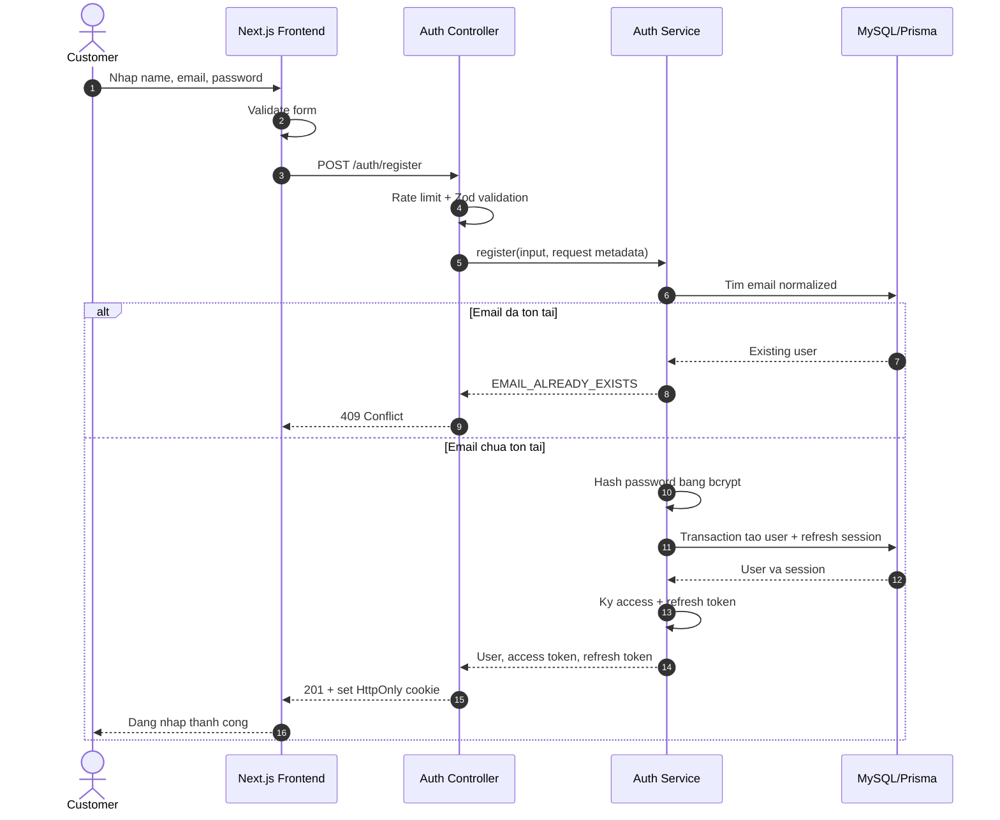
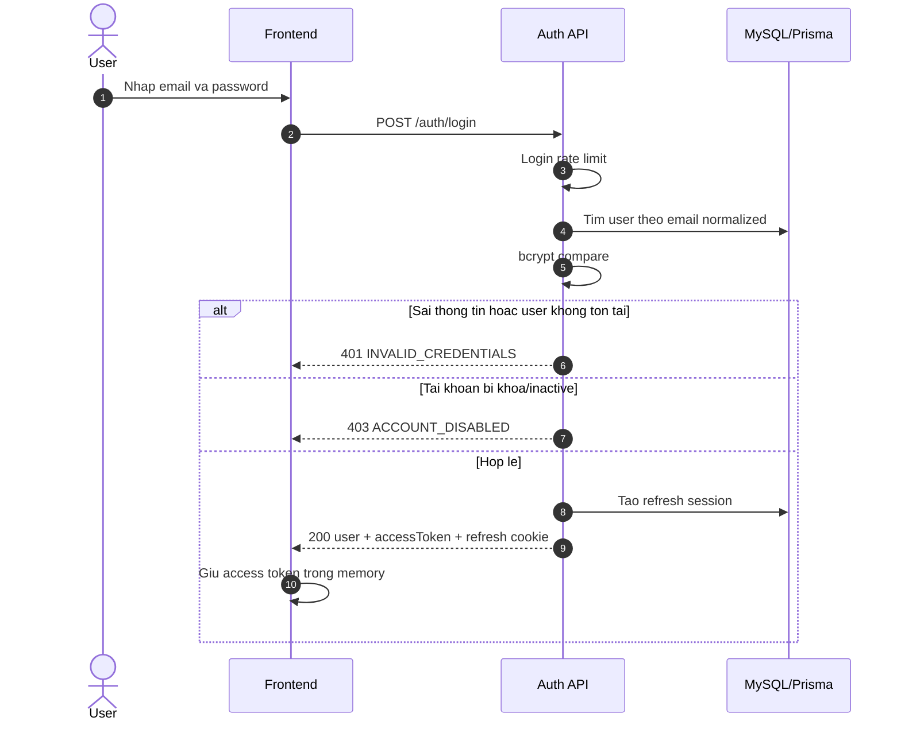
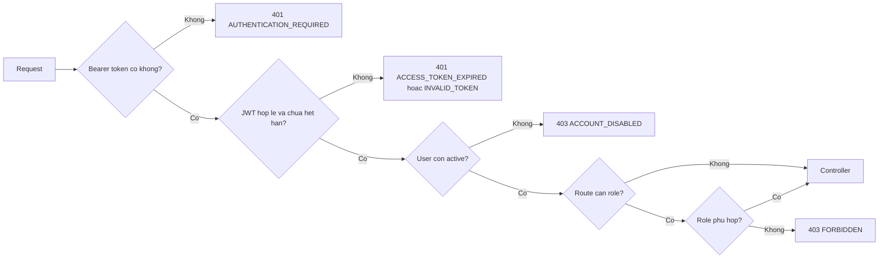
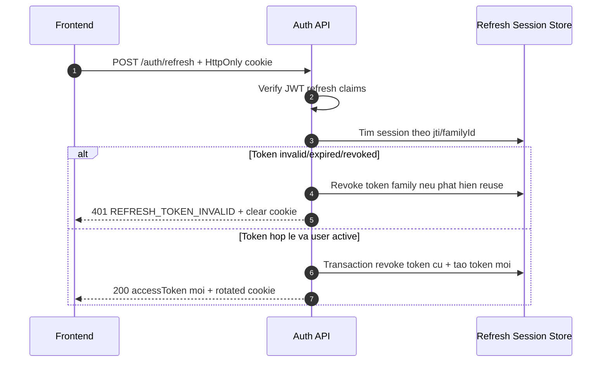

# PHASE 2 - AUTHENTICATION FLOW

## 1. Muc Tieu Va Lua Chon

He thong dung hai loai token:

- Access token la JWT song ngan, mac dinh 15 phut.
- Refresh token la JWT ngau nhien co `jti`, song 7 ngay, duoc rotate sau moi lan refresh.

Access token duoc frontend giu trong memory va gui qua `Authorization: Bearer`. Refresh token duoc luu trong cookie `HttpOnly`, `Secure` o production, `SameSite=Lax`, chi gioi han path auth. Database chi luu hash cua refresh token, khong luu token thuan.

Lua chon nay giam kha nang token bi doc boi script khi co XSS, dong thoi cho phep revoke session va phat hien refresh token bi tai su dung.

## 2. Token Claims

Access token payload toi thieu:

```json
{
  "sub": "user_01J...",
  "role": "CUSTOMER",
  "type": "access",
  "iat": 1791187200,
  "exp": 1791188100,
  "iss": "f1-fashion-store-api",
  "aud": "f1-fashion-store-web"
}
```

Refresh token payload:

```json
{
  "sub": "user_01J...",
  "jti": "session_01J...",
  "familyId": "family_01J...",
  "type": "refresh",
  "iat": 1791187200,
  "exp": 1791792000,
  "iss": "f1-fashion-store-api",
  "aud": "f1-fashion-store-web"
}
```

Khong dua email, password, phone hoac du lieu nhay cam vao token. Role trong access token giup check nhanh, nhung admin route van nap user/session can thiet de bao dam tai khoan con active.

## 3. Refresh Session Data

Moi refresh session can cac field logic sau; schema chinh xac se chot o Phase 3:

| Field | Mo ta |
|---|---|
| `id/jti` | ID duy nhat cua session token hien tai |
| `familyId` | Nhom token de phat hien reuse sau rotation |
| `userId` | Chu session |
| `tokenHash` | SHA-256/HMAC hash cua refresh token |
| `expiresAt` | Han su dung |
| `revokedAt` | Thoi diem revoke neu co |
| `replacedById` | Token moi thay token cu |
| `createdAt` | Thoi diem tao |
| `ipAddress` | Audit, duoc xu ly theo chinh sach privacy |
| `userAgent` | Audit/session management |

## 4. Register Flow



Quy tac:

- Email trim va lowercase truoc khi kiem tra.
- Database unique constraint la hang bao ve cuoi cung cho race condition.
- Password hash voi bcrypt cost duoc cau hinh qua env; khoi dau 12 va benchmark khi deploy.
- Response user khong bao gio co `passwordHash`.

## 5. Login Flow



Thong bao login sai khong tiet lo email co ton tai hay khong. Co rate limit theo IP va email normalized, va co the them delay nhe de giam brute force.

## 6. Authenticated Request

Middleware `authenticate`:

1. Doc Bearer token.
2. Verify signature, `exp`, `iss`, `aud` va `type=access`.
3. Lay `sub` va role.
4. Nap user toi thieu hoac dung cache ngan; tu choi neu user inactive/deleted.
5. Gan `req.auth = { userId, role }`.
6. Khong co/sai token tra `401`; token dung nhung sai role tra `403`.

Middleware `authorize("ADMIN")` chi chay sau `authenticate`.



## 7. Refresh Token Rotation



Refresh request dong thoi voi cung token chi co mot request thanh cong. Request con lai thay token da revoke va bi tu choi. Frontend can dung mot refresh promise chung de nhieu request 401 khong refresh dong loat.

Phat hien reuse:

- Neu token cu da rotate lai xuat hien, revoke toan bo `familyId`.
- Clear cookie va bat user login lai.
- Ghi security log khong chua token thuan.

## 8. Frontend Refresh Strategy

Axios client du kien:

1. Gui API request voi access token trong memory.
2. Neu nhan `401 ACCESS_TOKEN_EXPIRED`, tam dung request loi.
3. Neu chua co refresh dang chay, goi mot lan `POST /auth/refresh` voi `withCredentials: true`.
4. Request khac cho cung Promise, khong tao refresh storm.
5. Refresh thanh cong: cap nhat token memory va retry moi request toi da mot lan.
6. Refresh that bai: xoa auth state, chuyen den login, khong lap vo han.

Khi reload trang, frontend co the goi refresh mot lan de khoi phuc session; khong can luu access token vao `localStorage`.

## 9. Logout Flows

### Logout current session

- `POST /auth/logout` doc refresh cookie.
- Revoke session neu ton tai; thao tac idempotent.
- Clear cookie ke ca token da het han/sai.
- Tra `204 No Content`.

### Logout all sessions

- `POST /auth/logout-all` can access token hop le.
- Revoke tat ca refresh session cua user.
- Clear cookie hien tai.
- Access token da phat hanh co the con song toi da 15 phut; voi endpoint nhay cam co the kiem tra `tokenVersion` neu can revoke ngay.

### Password changed/reset

- Revoke tat ca refresh session.
- Tang `tokenVersion` cua user neu can vo hieu access token ngay.
- Tao session moi chi trong change-password cua user dang dang nhap; reset-password bat user login lai de don gian va an toan.

## 10. Forgot And Reset Password

1. User gui email toi `/auth/forgot-password`.
2. API luon tra cung mot thong bao de tranh email enumeration.
3. Neu user ton tai, tao random opaque token bang CSPRNG, luu hash va expiry 15 phut.
4. Gui link frontend chua token thuan qua email provider.
5. `/auth/reset-password` hash token de tim record, kiem tra chua dung/chua het han.
6. Trong transaction: cap nhat password hash, danh dau token da dung, revoke sessions.
7. Moi token chi duoc dung mot lan.

Giai doan chua tich hop email co the log link vao development console, nhung khong log trong production.

## 11. Cookie And CORS Configuration

Production cookie du kien:

```text
HttpOnly=true
Secure=true
SameSite=Lax
Path=/api/v1/auth
Max-Age=7 days
```

Neu frontend va API nam khac site va buoc phai dung `SameSite=None`, he thong phai them CSRF token/origin check nghiem ngat. CORS chi allow cac origin khai bao trong env, bat `credentials: true`, khong dung wildcard voi credential.

## 12. Security Controls

- Secrets access/refresh tach rieng, toi thieu 256 bit va nam trong env/secret manager.
- Khong log `Authorization`, cookie, password, reset token.
- Helmet, CORS allowlist, body size limit va rate limit.
- Zod strict validation va output mapping.
- bcrypt cho password; so sanh hash bang thu vien chuan.
- Refresh token hash bang SHA-256/HMAC truoc khi luu.
- Admin route kiem tra role server-side.
- User status duoc kiem tra, khong chi tin claim cu.
- `requestId` va security audit event ho tro dieu tra.
- Loi auth khong tra stack trace hoac ly do crypto chi tiet.

## 13. Auth State And Error Matrix

| Tinh huong | HTTP | Code | Frontend action |
|---|---:|---|---|
| Khong co access token | 401 | `AUTHENTICATION_REQUIRED` | Mo login |
| Access token het han | 401 | `ACCESS_TOKEN_EXPIRED` | Refresh mot lan |
| Access token sai | 401 | `INVALID_ACCESS_TOKEN` | Xoa state, login lai |
| Refresh token het han/sai | 401 | `REFRESH_TOKEN_INVALID` | Clear auth, login lai |
| User inactive | 403 | `ACCOUNT_DISABLED` | Logout va thong bao |
| Customer vao admin | 403 | `FORBIDDEN` | Hien trang 403 |
| Sai email/password | 401 | `INVALID_CREDENTIALS` | Hien loi chung |
| Email register trung | 409 | `EMAIL_ALREADY_EXISTS` | Bao tren field email |
| Vuot rate limit | 429 | `RATE_LIMIT_EXCEEDED` | Cho va thu lai |

## 14. Test Cases Bat Buoc Cho Phase 14

- Register thanh cong va email duoc normalize.
- Register email trung ke ca khac hoa/thuong.
- Password duoi 8 ky tu bi reject.
- Login thanh cong, sai password, user inactive.
- Access token dung/sai/het han.
- Customer bi chan tai admin API.
- Refresh thanh cong va token cu bi revoke.
- Hai refresh dong thoi chi mot request thanh cong.
- Reuse token cu revoke token family.
- Logout idempotent va cookie duoc clear.
- Logout all revoke moi session.
- Reset token het han/da dung bi reject.
- Response khong lo password hash/token nhay cam.

## 15. Bien Moi Truong Du Kien

```text
JWT_ACCESS_SECRET=
JWT_REFRESH_SECRET=
JWT_ISSUER=f1-fashion-store-api
JWT_AUDIENCE=f1-fashion-store-web
ACCESS_TOKEN_TTL=15m
REFRESH_TOKEN_TTL=7d
BCRYPT_ROUNDS=12
REFRESH_COOKIE_NAME=f1_refresh
FRONTEND_URL=http://localhost:3000
```

Gia tri secret chi nam trong `.env`, file `.env.example` de trong va khong commit secret that.
