# PHASE 3 - DATABASE DESIGN AND ERD

## 1. Muc Tieu

Tai lieu nay chot thiet ke logic cho MySQL truoc khi chuyen sang Prisma Schema o Phase 4. Mo hinh phai ho tro day du:

- Customer va admin authentication.
- Product, brand, category, size, color va variant.
- Cart, favorite va address.
- Checkout an toan, order snapshot va idempotency.
- Coupon usage theo user.
- Inventory audit va cancel hoan kho dung mot lan.
- Review sau khi mua hang.
- COD hien tai va online payment trong tuong lai.
- Upload anh local/Cloudinary.

## 2. Database Conventions

### 2.1 Database engine

- MySQL 8.0+.
- Storage engine `InnoDB` de ho tro foreign key, row-level locking va transaction.
- Character set `utf8mb4`, collation `utf8mb4_unicode_ci` hoac collation Unicode phu hop cua MySQL 8.
- Tat ca thoi gian duoc luu theo UTC va chuyen timezone o presentation layer.

### 2.2 Naming

- Prisma model dung PascalCase, vi du `ProductVariant`.
- Bang MySQL dung snake_case va so nhieu qua `@@map`, vi du `product_variants`.
- Column database dung snake_case; field Prisma dung camelCase.
- Foreign key co hau to `Id` trong Prisma va `_id` trong MySQL.
- Unique/index duoc dat ten ro rang de debug migration.

### 2.3 ID strategy

- Primary key dung CUID2/CUID string tao tai application.
- MySQL type du kien `VARCHAR(32)`.
- ID public khong de lo so luong record nhu auto-increment.
- `orderCode` van la ma nghiep vu ngan, unique va de customer/admin tim kiem.

### 2.4 Date and timestamp

- `createdAt`, `updatedAt`: `DATETIME(3)`.
- `createdAt` default now.
- `updatedAt` duoc Prisma tu cap nhat.
- Cac thoi diem optional nhu `deletedAt`, `revokedAt`, `paidAt` la nullable.

### 2.5 Money and quantity

- Money: `DECIMAL(12,2)`, khong dung `FLOAT`/`DOUBLE`.
- Discount percent: `DECIMAL(5,2)`.
- Stock/quantity/count: `INT UNSIGNED` o muc database neu Prisma/migration ho tro.
- Application dung Decimal type khi tinh tien.

### 2.6 Soft delete and immutable history

- `User`, `Category`, `Brand`, `Product`, `ProductVariant`, `Coupon`, `Review` uu tien inactive/soft delete.
- `Order`, `OrderItem`, `InventoryTransaction`, `OrderStatusHistory`, `Payment`, `CouponRedemption` la lich su nghiep vu, khong xoa bang API thong thuong.
- Foreign key cua du lieu giao dich uu tien `RESTRICT` hoac `SET NULL`; khong cascade delete lich su.

## 3. Enum Design

| Enum | Values | Ghi chu |
|---|---|---|
| `UserRole` | `CUSTOMER`, `ADMIN` | Role server-side |
| `ProductStatus` | `DRAFT`, `ACTIVE`, `INACTIVE` | Product chi public khi ACTIVE |
| `InventoryTransactionType` | `IMPORT`, `SALE`, `CANCEL_RETURN`, `MANUAL_ADJUSTMENT`, `RETURN` | Moi bien dong stock |
| `OrderStatus` | `PENDING`, `CONFIRMED`, `SHIPPING`, `DELIVERED`, `CANCELLED` | Transition theo Phase 2 |
| `PaymentMethod` | `COD`, `VNPAY`, `MOMO` | Hai method online de mo rong |
| `PaymentStatus` | `UNPAID`, `PENDING`, `PAID`, `FAILED`, `REFUNDED` | Tach khoi order status |
| `PaymentProvider` | `COD`, `VNPAY`, `MOMO` | Provider giao dich |
| `CouponType` | `PERCENT`, `FIXED` | Cach tinh discount |
| `CouponRedemptionStatus` | `APPLIED`, `RELEASED` | RELEASED khi cancel theo policy |
| `ReviewStatus` | `PENDING`, `APPROVED`, `REJECTED`, `HIDDEN` | Moderation |
| `IdempotencyStatus` | `IN_PROGRESS`, `COMPLETED`, `FAILED` | Trang thai checkout request |
| `UploadProviderType` | `LOCAL`, `CLOUDINARY` | Provider asset |

MySQL enum hay string-backed enum se duoc Prisma quyet dinh o Phase 4. Business logic khong duoc dua vao thu tu enum.

## 4. Entity Overview

| Nhom | Entities |
|---|---|
| Identity | `User`, `RefreshSession`, `PasswordResetToken`, `Address` |
| Catalog | `Category`, `Brand`, `Product`, `ProductImage`, `Size`, `Color`, `ProductVariant`, `UploadAsset` |
| Shopping | `Cart`, `CartItem`, `Favorite` |
| Promotion | `Coupon`, `CouponRedemption` |
| Order | `Order`, `OrderItem`, `OrderStatusHistory`, `CheckoutIdempotency`, `Payment` |
| Engagement | `Review` |
| Inventory | `InventoryTransaction` |

Tong cong: **24 entities**.

## 5. Full Mermaid ERD

```mermaid
erDiagram
  User {
    string id PK
    string email UK
    string passwordHash
    string fullName
    string phone
    string avatarUrl
    UserRole role
    boolean isActive
    int tokenVersion
    datetime createdAt
    datetime updatedAt
    datetime deletedAt
  }

  RefreshSession {
    string id PK
    string userId FK
    string familyId
    string tokenHash UK
    datetime expiresAt
    datetime revokedAt
    string replacedById FK
    string ipAddress
    string userAgent
    datetime createdAt
  }

  PasswordResetToken {
    string id PK
    string userId FK
    string tokenHash UK
    datetime expiresAt
    datetime usedAt
    datetime createdAt
  }

  Address {
    string id PK
    string userId FK
    string recipientName
    string phone
    string line1
    string line2
    string ward
    string district
    string province
    string postalCode
    boolean isDefault
    datetime createdAt
    datetime updatedAt
  }

  Category {
    string id PK
    string name
    string slug UK
    string description
    string imageUrl
    boolean isActive
    int sortOrder
    datetime createdAt
    datetime updatedAt
    datetime deletedAt
  }

  Brand {
    string id PK
    string name
    string slug UK
    string logoUrl
    string description
    boolean isActive
    int sortOrder
    datetime createdAt
    datetime updatedAt
    datetime deletedAt
  }

  Product {
    string id PK
    string categoryId FK
    string brandId FK
    string name
    string slug UK
    string shortDescription
    text description
    decimal basePrice
    decimal salePrice
    ProductStatus status
    boolean isFeatured
    datetime publishedAt
    datetime createdAt
    datetime updatedAt
    datetime deletedAt
  }

  UploadAsset {
    string id PK
    UploadProviderType provider
    string providerAssetId
    string url
    int width
    int height
    string format
    int bytes
    string uploadedById FK
    datetime createdAt
    datetime deletedAt
  }

  ProductImage {
    string id PK
    string productId FK
    string assetId FK
    string urlSnapshot
    string altText
    int sortOrder
    boolean isPrimary
    datetime createdAt
  }

  Size {
    string id PK
    string name UK
    string slug UK
    int sortOrder
    boolean isActive
  }

  Color {
    string id PK
    string name UK
    string slug UK
    string hexCode
    int sortOrder
    boolean isActive
  }

  ProductVariant {
    string id PK
    string productId FK
    string sizeId FK
    string colorId FK
    string sku UK
    decimal price
    decimal salePrice
    int stock
    boolean isActive
    datetime createdAt
    datetime updatedAt
    datetime deletedAt
  }

  InventoryTransaction {
    string id PK
    string variantId FK
    string orderId FK
    string orderItemId FK
    string createdById FK
    InventoryTransactionType type
    int quantityDelta
    int stockBefore
    int stockAfter
    string reference
    string reason
    datetime createdAt
  }

  Cart {
    string id PK
    string userId FK
    datetime createdAt
    datetime updatedAt
  }

  CartItem {
    string id PK
    string cartId FK
    string variantId FK
    int quantity
    datetime createdAt
    datetime updatedAt
  }

  Favorite {
    string id PK
    string userId FK
    string productId FK
    datetime createdAt
  }

  Coupon {
    string id PK
    string code UK
    CouponType type
    decimal value
    decimal minOrderValue
    decimal maxDiscount
    datetime startAt
    datetime endAt
    int usageLimit
    int perUserLimit
    int usedCount
    boolean isActive
    datetime createdAt
    datetime updatedAt
    datetime deletedAt
  }

  Order {
    string id PK
    string userId FK
    string couponId FK
    string orderCode UK
    OrderStatus status
    PaymentMethod paymentMethod
    PaymentStatus paymentStatus
    string receiverName
    string receiverPhone
    string receiverEmail
    string addressLine1
    string addressLine2
    string ward
    string district
    string province
    string postalCode
    string couponCode
    string note
    decimal subtotal
    decimal discount
    decimal shippingFee
    decimal total
    datetime paidAt
    datetime deliveredAt
    datetime cancelledAt
    datetime createdAt
    datetime updatedAt
  }

  OrderItem {
    string id PK
    string orderId FK
    string productId FK
    string variantId FK
    string productName
    string sku
    string size
    string color
    string imageUrl
    decimal unitPrice
    int quantity
    decimal subtotal
    datetime createdAt
  }

  OrderStatusHistory {
    string id PK
    string orderId FK
    string actorId FK
    OrderStatus fromStatus
    OrderStatus toStatus
    string note
    datetime createdAt
  }

  CouponRedemption {
    string id PK
    string couponId FK
    string userId FK
    string orderId FK
    CouponRedemptionStatus status
    decimal discountAmount
    datetime appliedAt
    datetime releasedAt
  }

  CheckoutIdempotency {
    string id PK
    string userId FK
    string idempotencyKey
    string requestHash
    IdempotencyStatus status
    string orderId FK
    int responseStatus
    datetime expiresAt
    datetime createdAt
    datetime updatedAt
  }

  Payment {
    string id PK
    string orderId FK
    PaymentProvider provider
    string providerTransactionId
    decimal amount
    string currency
    PaymentStatus status
    json metadata
    datetime paidAt
    datetime createdAt
    datetime updatedAt
  }

  Review {
    string id PK
    string userId FK
    string productId FK
    string orderItemId FK
    int rating
    string title
    text content
    ReviewStatus status
    datetime createdAt
    datetime updatedAt
    datetime deletedAt
  }

  User ||--o{ RefreshSession : owns
  User ||--o{ PasswordResetToken : requests
  User ||--o{ Address : has
  User ||--o| Cart : owns
  User ||--o{ Favorite : creates
  User ||--o{ Order : places
  User ||--o{ Review : writes
  User ||--o{ CouponRedemption : uses
  User ||--o{ CheckoutIdempotency : sends
  User o|--o{ UploadAsset : uploads
  User o|--o{ InventoryTransaction : adjusts
  User o|--o{ OrderStatusHistory : changes

  Category ||--o{ Product : classifies
  Brand ||--o{ Product : owns
  Product ||--o{ ProductImage : displays
  UploadAsset o|--o{ ProductImage : backs
  Product ||--o{ ProductVariant : has
  Size ||--o{ ProductVariant : sizes
  Color ||--o{ ProductVariant : colors
  Product ||--o{ Favorite : favored
  Product ||--o{ Review : receives
  Product o|--o{ OrderItem : snapshots

  Cart ||--o{ CartItem : contains
  ProductVariant ||--o{ CartItem : selected
  ProductVariant ||--o{ InventoryTransaction : records
  ProductVariant o|--o{ OrderItem : snapshots

  Coupon o|--o{ Order : discounts
  Coupon ||--o{ CouponRedemption : redeems
  Order ||--|{ OrderItem : contains
  Order ||--o{ OrderStatusHistory : tracks
  Order ||--o{ InventoryTransaction : causes
  Order ||--o| CouponRedemption : applies
  Order ||--o{ Payment : pays
  Order o|--o| CheckoutIdempotency : resolves
  OrderItem o|--o{ InventoryTransaction : causes
  OrderItem ||--o| Review : verifies
```



## 6. Identity Tables

### 6.1 User

| Column | Type | Null | Constraint/Default | Mo ta |
|---|---|---:|---|---|
| `id` | VARCHAR(32) | No | PK | User ID |
| `email` | VARCHAR(254) | No | UNIQUE | Lowercase normalized email |
| `password_hash` | VARCHAR(255) | No | - | bcrypt hash |
| `full_name` | VARCHAR(100) | No | - | Ten hien thi |
| `phone` | VARCHAR(20) | Yes | INDEX | So dien thoai |
| `avatar_url` | VARCHAR(2048) | Yes | - | Avatar |
| `role` | ENUM/string | No | `CUSTOMER` | Customer/admin |
| `is_active` | BOOLEAN | No | true | Khoa/mo tai khoan |
| `token_version` | INT | No | 0 | Revoke access token khi can |
| `created_at` | DATETIME(3) | No | now | - |
| `updated_at` | DATETIME(3) | No | auto | - |
| `deleted_at` | DATETIME(3) | Yes | INDEX | Soft delete |

Rules:

- Email unique sau normalize trim/lowercase.
- API khong bao gio select/serialize `passwordHash` theo mac dinh.
- Khong hard delete user da co order.
- Index `(role, isActive)` cho admin customer filter.

### 6.2 RefreshSession

| Column | Type | Null | Constraint/Default | Mo ta |
|---|---|---:|---|---|
| `id` | VARCHAR(32) | No | PK, JWT `jti` | Session token hien tai |
| `user_id` | VARCHAR(32) | No | FK User | Chu session |
| `family_id` | VARCHAR(32) | No | INDEX | Nhom token rotation |
| `token_hash` | CHAR(64) | No | UNIQUE | SHA-256/HMAC hash |
| `expires_at` | DATETIME(3) | No | INDEX | Han token |
| `revoked_at` | DATETIME(3) | Yes | INDEX | Revoke time |
| `replaced_by_id` | VARCHAR(32) | Yes | SELF FK, UNIQUE | Token ke tiep |
| `ip_address` | VARCHAR(45) | Yes | - | IPv4/IPv6 audit |
| `user_agent` | VARCHAR(512) | Yes | - | Device audit |
| `created_at` | DATETIME(3) | No | now | - |

Indexes: `(user_id, revoked_at)`, `(family_id, revoked_at)`, `(expires_at)`.

Delete policy: `User -> RefreshSession CASCADE` chi khi user thuc su purge; self FK `SET NULL` de khong can xoa chuoi theo thu tu.

### 6.3 PasswordResetToken

| Column | Type | Null | Constraint/Default |
|---|---|---:|---|
| `id` | VARCHAR(32) | No | PK |
| `user_id` | VARCHAR(32) | No | FK User |
| `token_hash` | CHAR(64) | No | UNIQUE |
| `expires_at` | DATETIME(3) | No | INDEX |
| `used_at` | DATETIME(3) | Yes | INDEX |
| `created_at` | DATETIME(3) | No | now |

Delete policy: CASCADE khi purge user. Service chi chap nhan token `usedAt IS NULL AND expiresAt > now`.

### 6.4 Address

| Column | Type | Null | Constraint/Default |
|---|---|---:|---|
| `id` | VARCHAR(32) | No | PK |
| `user_id` | VARCHAR(32) | No | FK User |
| `recipient_name` | VARCHAR(100) | No | - |
| `phone` | VARCHAR(20) | No | - |
| `line1` | VARCHAR(255) | No | - |
| `line2` | VARCHAR(255) | Yes | - |
| `ward` | VARCHAR(100) | No | - |
| `district` | VARCHAR(100) | No | - |
| `province` | VARCHAR(100) | No | - |
| `postal_code` | VARCHAR(20) | Yes | - |
| `is_default` | BOOLEAN | No | false |
| `created_at` | DATETIME(3) | No | now |
| `updated_at` | DATETIME(3) | No | auto |

Index `(user_id, is_default)`. MySQL/Prisma khong co portable partial unique de dam bao chi mot default address; service cap nhat trong transaction: unset default cu, sau do set record moi.

Delete policy: CASCADE khi purge user. Order khong FK vao Address ma luu snapshot, nen xoa address khong anh huong order cu.

## 7. Catalog Tables

### 7.1 Category

Fields: `id`, `name VARCHAR(100)`, `slug VARCHAR(120) UNIQUE`, `description TEXT?`, `imageUrl VARCHAR(2048)?`, `isActive BOOLEAN`, `sortOrder INT`, timestamps, `deletedAt?`.

Indexes: `(is_active, sort_order)`, `(name)`.

Delete policy voi Product: `RESTRICT`; endpoint delete thuc hien soft delete/deactivate.

### 7.2 Brand

Fields: `id`, `name VARCHAR(100)`, `slug VARCHAR(120) UNIQUE`, `logoUrl VARCHAR(2048)?`, `description TEXT?`, `isActive BOOLEAN`, `sortOrder INT`, timestamps, `deletedAt?`.

Indexes: `(is_active, sort_order)`, `(name)`.

Delete policy voi Product: `RESTRICT`; thuong hieu da co product khong hard delete.

### 7.3 Product

| Column | Type | Null | Constraint/Default |
|---|---|---:|---|
| `id` | VARCHAR(32) | No | PK |
| `category_id` | VARCHAR(32) | No | FK Category |
| `brand_id` | VARCHAR(32) | No | FK Brand |
| `name` | VARCHAR(200) | No | INDEX |
| `slug` | VARCHAR(220) | No | UNIQUE |
| `short_description` | VARCHAR(500) | Yes | - |
| `description` | TEXT | Yes | - |
| `base_price` | DECIMAL(12,2) | No | >= 0 |
| `sale_price` | DECIMAL(12,2) | Yes | >= 0, <= base price |
| `status` | enum | No | `DRAFT` |
| `is_featured` | BOOLEAN | No | false |
| `published_at` | DATETIME(3) | Yes | - |
| timestamps/deleted | DATETIME(3) | mixed | - |

Indexes:

- `(status, created_at)` cho storefront newest.
- `(category_id, status)`.
- `(brand_id, status)`.
- `(is_featured, status)`.
- FULLTEXT `(name, short_description, description)` co the them bang raw migration neu MySQL search duoc chon; giai doan dau dung indexed prefix/contains co gioi han.

Price rule: Product price la gia mac dinh. Variant co the override. Effective price:

```text
COALESCE(variant.salePrice, variant.price, product.salePrice, product.basePrice)
```

Product chi chuyen sang `ACTIVE` khi co it nhat mot image va mot variant active.

### 7.4 UploadAsset

| Column | Type | Null | Constraint/Default |
|---|---|---:|---|
| `id` | VARCHAR(32) | No | PK |
| `provider` | enum | No | LOCAL/CLOUDINARY |
| `provider_asset_id` | VARCHAR(255) | No | UNIQUE voi provider |
| `url` | VARCHAR(2048) | No | - |
| `width`, `height` | INT | Yes | > 0 |
| `format` | VARCHAR(20) | No | - |
| `bytes` | INT UNSIGNED | No | > 0 |
| `uploaded_by_id` | VARCHAR(32) | Yes | FK User, SET NULL |
| `created_at` | DATETIME(3) | No | now |
| `deleted_at` | DATETIME(3) | Yes | INDEX |

Unique nen la `(provider, provider_asset_id)` thay vi chi provider ID neu local/cloud co the trung namespace.

### 7.5 ProductImage

| Column | Type | Null | Constraint/Default |
|---|---|---:|---|
| `id` | VARCHAR(32) | No | PK |
| `product_id` | VARCHAR(32) | No | FK Product |
| `asset_id` | VARCHAR(32) | Yes | FK UploadAsset, SET NULL |
| `url_snapshot` | VARCHAR(2048) | No | URL de van hien thi khi asset metadata thay doi |
| `alt_text` | VARCHAR(255) | Yes | - |
| `sort_order` | INT | No | 0 |
| `is_primary` | BOOLEAN | No | false |
| `created_at` | DATETIME(3) | No | now |

Constraints/indexes: UNIQUE `(product_id, sort_order)`, INDEX `(product_id, is_primary)`. Service dam bao toi da mot primary image va luon sap xep lai sortOrder trong transaction.

Delete policy: Product -> ProductImage CASCADE chi khi hard purge product draft; UploadAsset -> ProductImage SET NULL.

### 7.6 Size And Color

`Size`: `id`, `name UNIQUE`, `slug UNIQUE`, `sortOrder`, `isActive`.

`Color`: `id`, `name UNIQUE`, `slug UNIQUE`, `hexCode CHAR(7)?`, `sortOrder`, `isActive`.

Delete policy voi variant: `RESTRICT`; size/color da su dung chi deactivate.

### 7.7 ProductVariant

| Column | Type | Null | Constraint/Default |
|---|---|---:|---|
| `id` | VARCHAR(32) | No | PK |
| `product_id` | VARCHAR(32) | No | FK Product |
| `size_id` | VARCHAR(32) | No | FK Size |
| `color_id` | VARCHAR(32) | No | FK Color |
| `sku` | VARCHAR(64) | No | UNIQUE, uppercase normalized |
| `price` | DECIMAL(12,2) | Yes | Override, >= 0 |
| `sale_price` | DECIMAL(12,2) | Yes | Override, >= 0 |
| `stock` | INT UNSIGNED | No | 0 |
| `is_active` | BOOLEAN | No | true |
| timestamps/deleted | DATETIME(3) | mixed | - |

Constraints:

- UNIQUE `(product_id, size_id, color_id)`.
- CHECK `stock >= 0`.
- CHECK `price IS NULL OR price >= 0`.
- CHECK `sale_price IS NULL OR sale_price >= 0`.
- Neu ca `price` va `salePrice` null thi dung product price.

Indexes: `(product_id, is_active)`, `(stock, is_active)`, `(size_id, stock)`, `(color_id, stock)`.

Delete policy: tat ca FK catalog `RESTRICT`; variant duoc soft delete/deactivate vi co the da xuat hien trong OrderItem/InventoryTransaction.

## 8. Shopping Tables

### 8.1 Cart

Fields: `id`, `userId`, `createdAt`, `updatedAt`.

Constraint: UNIQUE `user_id`, nen moi user co toi da mot server cart. Delete policy: User -> Cart CASCADE.

### 8.2 CartItem

Fields: `id`, `cartId`, `variantId`, `quantity`, timestamps.

Constraints:

- UNIQUE `(cart_id, variant_id)`.
- CHECK `quantity >= 1`.
- Cart -> CartItem CASCADE.
- Variant -> CartItem CASCADE hoac RESTRICT; chon `RESTRICT` va service xoa item khi variant inactive de tranh cascade ngoai y muon.

Index `(variant_id)` de tim cart bi anh huong khi variant thay doi.

### 8.3 Favorite

Fields: `id`, `userId`, `productId`, `createdAt`.

Constraint UNIQUE `(user_id, product_id)`. User -> Favorite CASCADE; Product -> Favorite CASCADE chi khi hard purge product draft, con product da public duoc soft delete.

## 9. Promotion Tables

### 9.1 Coupon

| Column | Type | Null | Constraint/Default |
|---|---|---:|---|
| `id` | VARCHAR(32) | No | PK |
| `code` | VARCHAR(50) | No | UNIQUE, uppercase normalized |
| `type` | enum | No | PERCENT/FIXED |
| `value` | DECIMAL(12,2) | No | > 0 |
| `min_order_value` | DECIMAL(12,2) | No | 0 |
| `max_discount` | DECIMAL(12,2) | Yes | > 0 |
| `start_at` | DATETIME(3) | No | - |
| `end_at` | DATETIME(3) | No | - |
| `usage_limit` | INT UNSIGNED | Yes | > 0 |
| `per_user_limit` | INT UNSIGNED | Yes | > 0 |
| `used_count` | INT UNSIGNED | No | 0 |
| `is_active` | BOOLEAN | No | true |
| timestamps/deleted | DATETIME(3) | mixed | - |

Rules:

- `endAt > startAt`.
- PERCENT: `0 < value <= 100`; FIXED: `value > 0`.
- `usedCount <= usageLimit` neu co limit.
- `usedCount` la denormalized counter cap nhat atomic trong checkout/cancel transaction.

Indexes: `(code, is_active)`, `(is_active, start_at, end_at)`.

### 9.2 CouponRedemption

| Column | Type | Null | Constraint/Default |
|---|---|---:|---|
| `id` | VARCHAR(32) | No | PK |
| `coupon_id` | VARCHAR(32) | No | FK Coupon |
| `user_id` | VARCHAR(32) | No | FK User |
| `order_id` | VARCHAR(32) | No | FK Order, UNIQUE |
| `status` | enum | No | APPLIED |
| `discount_amount` | DECIMAL(12,2) | No | >= 0 |
| `applied_at` | DATETIME(3) | No | now |
| `released_at` | DATETIME(3) | Yes | - |

Constraints/indexes: UNIQUE `(coupon_id, order_id)`, INDEX `(coupon_id, status)`, INDEX `(coupon_id, user_id, status)`.

Coupon, User, Order delete policy `RESTRICT`. Per-user usage duoc dem tren redemption `APPLIED`; cancel chuyen `RELEASED` va decrement counter theo cung transaction.

## 10. Order Tables

### 10.1 Order

Order la aggregate root cua checkout.

| Nhom | Columns |
|---|---|
| Identity | `id`, `orderCode UNIQUE`, `userId FK`, `couponId? FK` |
| State | `status`, `paymentMethod`, `paymentStatus` |
| Receiver snapshot | `receiverName`, `receiverPhone`, `receiverEmail?` |
| Address snapshot | `addressLine1`, `addressLine2?`, `ward`, `district`, `province`, `postalCode?` |
| Promotion snapshot | `couponCode?`, `discount` |
| Money | `subtotal`, `shippingFee`, `total` |
| Other | `note?`, `paidAt?`, `deliveredAt?`, `cancelledAt?`, timestamps |

Constraints:

- `orderCode` unique, format vi du `F1-20261005-ABC123`.
- Tat ca money `>= 0`.
- `total = max(0, subtotal - discount) + shippingFee`; service tinh va snapshot.
- `couponId` nullable va delete policy `SET NULL`, nhung `couponCode`/discount snapshot van con.
- `userId` RESTRICT; user co order khong hard delete.

Indexes:

- `(user_id, created_at DESC)` cho My Orders.
- `(status, created_at DESC)` cho admin order queue.
- `(payment_status, created_at DESC)`.
- `(created_at)` cho dashboard/date range.
- `(delivered_at)` cho revenue.
- `(receiver_phone)` va `order_code` cho admin search.

### 10.2 OrderItem

| Column | Type | Null | Constraint/Default |
|---|---|---:|---|
| `id` | VARCHAR(32) | No | PK |
| `order_id` | VARCHAR(32) | No | FK Order |
| `product_id` | VARCHAR(32) | Yes | FK Product, SET NULL |
| `variant_id` | VARCHAR(32) | Yes | FK Variant, SET NULL |
| `product_name` | VARCHAR(200) | No | Snapshot |
| `sku` | VARCHAR(64) | No | Snapshot |
| `size` | VARCHAR(50) | No | Snapshot |
| `color` | VARCHAR(100) | No | Snapshot |
| `image_url` | VARCHAR(2048) | Yes | Snapshot |
| `unit_price` | DECIMAL(12,2) | No | >= 0 |
| `quantity` | INT UNSIGNED | No | >= 1 |
| `subtotal` | DECIMAL(12,2) | No | unitPrice * quantity |
| `created_at` | DATETIME(3) | No | now |

Index `(order_id)`, `(product_id)`, `(variant_id)`, `(sku)`. Order -> OrderItem `RESTRICT` de bao ve history; order khong co hard-delete API.

### 10.3 OrderStatusHistory

Fields: `id`, `orderId`, `actorId?`, `fromStatus?`, `toStatus`, `note?`, `createdAt`.

- Record dau tien co `fromStatus=NULL`, `toStatus=PENDING`.
- `actorId SET NULL` neu admin bi purge, history van con.
- Order -> history `RESTRICT`.
- Index `(order_id, created_at)`.
- Record immutable.

### 10.4 CheckoutIdempotency

| Column | Type | Null | Constraint/Default |
|---|---|---:|---|
| `id` | VARCHAR(32) | No | PK |
| `user_id` | VARCHAR(32) | No | FK User |
| `idempotency_key` | VARCHAR(64) | No | UUID tu client |
| `request_hash` | CHAR(64) | No | Canonical request SHA-256 |
| `status` | enum | No | IN_PROGRESS |
| `order_id` | VARCHAR(32) | Yes | FK Order, UNIQUE |
| `response_status` | SMALLINT | Yes | HTTP status cache |
| `expires_at` | DATETIME(3) | No | INDEX |
| timestamps | DATETIME(3) | No | - |

Constraint quan trong: UNIQUE `(user_id, idempotency_key)`. User/Order delete policy `RESTRICT`. Khong can luu response JSON neu co the tai tao response tu Order; tranh duplicate PII.

### 10.5 Payment

| Column | Type | Null | Constraint/Default |
|---|---|---:|---|
| `id` | VARCHAR(32) | No | PK |
| `order_id` | VARCHAR(32) | No | FK Order |
| `provider` | enum | No | COD/VNPAY/MOMO |
| `provider_transaction_id` | VARCHAR(255) | Yes | Provider-scoped unique |
| `amount` | DECIMAL(12,2) | No | >= 0 |
| `currency` | CHAR(3) | No | VND |
| `status` | enum | No | PENDING/PAID/FAILED/REFUNDED |
| `metadata` | JSON | Yes | Du lieu da loc, khong chua secret |
| `paid_at` | DATETIME(3) | Yes | - |
| timestamps | DATETIME(3) | No | - |

Unique `(provider, provider_transaction_id)` khi provider ID ton tai; do MySQL cho phep nhieu NULL trong unique composite. Index `(order_id, created_at)`, `(status, created_at)`. Mot order co nhieu payment attempt.

## 11. Inventory Table

### 11.1 InventoryTransaction

| Column | Type | Null | Constraint/Default |
|---|---|---:|---|
| `id` | VARCHAR(32) | No | PK |
| `variant_id` | VARCHAR(32) | No | FK Variant, RESTRICT |
| `order_id` | VARCHAR(32) | Yes | FK Order, RESTRICT |
| `order_item_id` | VARCHAR(32) | Yes | FK OrderItem, RESTRICT |
| `created_by_id` | VARCHAR(32) | Yes | FK User, SET NULL |
| `type` | enum | No | - |
| `quantity_delta` | INT | No | Khac 0 |
| `stock_before` | INT UNSIGNED | No | >= 0 |
| `stock_after` | INT UNSIGNED | No | >= 0 |
| `reference` | VARCHAR(100) | Yes | Batch/import reference |
| `reason` | VARCHAR(500) | Yes | Bat buoc voi manual adjustment |
| `created_at` | DATETIME(3) | No | now |

Checks:

- `stock_after = stock_before + quantity_delta`.
- `SALE` co delta am.
- `IMPORT`, `CANCEL_RETURN`, `RETURN` co delta duong.
- `MANUAL_ADJUSTMENT` co the am/duong.
- `quantityDelta != 0`.

Indexes:

- `(variant_id, created_at DESC)` cho inventory history.
- `(order_id)` va `(order_item_id)` cho audit.
- `(type, created_at)` cho reporting.
- `(reference)` cho import batch.

Record immutable. Database user cua app khong can quyen update/delete bang nay trong production neu deployment cho phep tach permission.

## 12. Review Table

### 12.1 Review

| Column | Type | Null | Constraint/Default |
|---|---|---:|---|
| `id` | VARCHAR(32) | No | PK |
| `user_id` | VARCHAR(32) | No | FK User |
| `product_id` | VARCHAR(32) | No | FK Product |
| `order_item_id` | VARCHAR(32) | No | FK OrderItem, UNIQUE |
| `rating` | TINYINT UNSIGNED | No | 1-5 |
| `title` | VARCHAR(150) | Yes | - |
| `content` | TEXT | Yes | - |
| `status` | enum | No | PENDING |
| timestamps/deleted | DATETIME(3) | mixed | - |

Constraints:

- UNIQUE `(user_id, product_id)` theo business rule mot review active cho moi product.
- UNIQUE `order_item_id` de mot item chi xac minh mot review.
- CHECK `rating BETWEEN 1 AND 5`.
- Service kiem tra order item thuoc user va order `DELIVERED`.

Indexes: `(product_id, status, created_at)`, `(product_id, rating)`, `(user_id, created_at)`.

Delete policy tat ca FK `RESTRICT`; review moderation/owner delete dung soft delete.

## 13. Relationship Cardinality Summary

| Parent | Child | Cardinality | Delete policy |
|---|---|---|---|
| User | RefreshSession | 1:N | CASCADE khi purge |
| User | Address | 1:N | CASCADE khi purge |
| User | Cart | 1:0..1 | CASCADE khi purge |
| User | Order | 1:N | RESTRICT |
| Category | Product | 1:N | RESTRICT |
| Brand | Product | 1:N | RESTRICT |
| Product | ProductImage | 1:N | CASCADE chi hard-purge draft |
| Product | ProductVariant | 1:N | RESTRICT |
| Size/Color | ProductVariant | 1:N | RESTRICT |
| Cart | CartItem | 1:N | CASCADE |
| ProductVariant | CartItem | 1:N | RESTRICT |
| Order | OrderItem | 1:N | RESTRICT |
| Order | StatusHistory | 1:N | RESTRICT |
| Order | Payment | 1:N | RESTRICT |
| Coupon | CouponRedemption | 1:N | RESTRICT |
| Order | CouponRedemption | 1:0..1 | RESTRICT |
| ProductVariant | InventoryTransaction | 1:N | RESTRICT |
| OrderItem | Review | 1:0..1 | RESTRICT |

## 14. Critical Unique Constraints

| Table | Constraint | Ly do |
|---|---|---|
| users | `email` | Khong trung tai khoan |
| refresh_sessions | `token_hash` | Moi token mot session |
| refresh_sessions | `replaced_by_id` | Mot token cu chi rotate mot lan |
| categories/brands/products | `slug` | SEO URL unique |
| product_variants | `sku` | SKU unique |
| product_variants | `(product_id, size_id, color_id)` | Khong trung combination |
| carts | `user_id` | Moi user mot cart |
| cart_items | `(cart_id, variant_id)` | Khong trung line item |
| favorites | `(user_id, product_id)` | Favorite idempotent |
| coupons | `code` | Coupon unique |
| orders | `order_code` | Ma order unique |
| coupon_redemptions | `order_id` | Mot order toi da mot coupon |
| checkout_idempotencies | `(user_id, idempotency_key)` | Khong tao trung order |
| reviews | `(user_id, product_id)` | Mot review/product/user |
| reviews | `order_item_id` | Mot item xac minh mot review |
| payments | `(provider, provider_transaction_id)` | Webhook/payment idempotency |

## 15. Database Constraints Vs Service Rules

Database constraints bat buoc cho invariant don gian va race condition:

- PK, FK, unique.
- Stock/quantity/rating/money non-negative.
- Unique idempotency key.
- Unique SKU, email, slug.

Service transaction bat buoc cho rule lien bang hoặc co state:

- Checkout stock conditional decrement.
- Chuyen order status dung transition.
- Cancel hoan stock mot lan.
- Coupon global/per-user limit.
- Chi mot default address.
- Chi mot primary product image.
- Review chi sau delivered purchase.
- Product chi publish khi co image va active variant.

Prisma Schema khong bieu dien duoc moi `CHECK`; Phase 4 se dung Prisma validation/service rule va raw SQL migration cho check constraint quan trong neu can.

## 16. Index Strategy By Query

| Query | Index chinh |
|---|---|
| Login by email | `users(email)` unique |
| Public product by slug | `products(slug)` unique |
| Product list category/brand/status | `(category_id,status)`, `(brand_id,status)` |
| Variant by SKU | `product_variants(sku)` unique |
| Low/out of stock | `(stock,is_active)` |
| My orders | `(user_id,created_at)` |
| Admin order status queue | `(status,created_at)` |
| Revenue by delivered date | `(delivered_at)` |
| Variant inventory history | `(variant_id,created_at)` |
| Coupon usage by user | `(coupon_id,user_id,status)` |
| Product approved reviews | `(product_id,status,created_at)` |
| Session family revoke | `(family_id,revoked_at)` |

Khong them index cho moi column. Phase test se dung `EXPLAIN` cho query catalog, orders, inventory va dashboard truoc khi bo sung index.

## 17. Transaction Boundaries

### Checkout transaction

Atomically tao: `CheckoutIdempotency`, `Order`, `OrderItem`, `InventoryTransaction`, `CouponRedemption`, `OrderStatusHistory`; cap nhat stock/coupon count; xoa CartItem.

### Cancel transaction

Atomically conditional update Order, tang ProductVariant stock, tao `CANCEL_RETURN`, cap nhat CouponRedemption/counter, tao OrderStatusHistory.

### Refresh rotation transaction

Atomically revoke RefreshSession cu va tao RefreshSession moi co `replacedById`.

### Inventory adjustment transaction

Atomically cap nhat ProductVariant stock va tao InventoryTransaction.

## 18. Data Retention And Privacy

- Password/reset/refresh token chi luu hash.
- Payment metadata khong luu card data, secret hoac raw response chua PII khong can thiet.
- Order address snapshot duoc giu theo chinh sach giao dich, ke ca user xoa address.
- Soft-deleted user co the anonymize profile sau retention period, nhung order snapshot phai duoc xu ly theo chinh sach phap ly ap dung.
- Refresh session het han va password reset token cu co the cleanup theo scheduled job.
- Checkout idempotency `FAILED/IN_PROGRESS` het han co the cleanup; completed record gan order nen giu theo audit policy.

## 19. Phase 4 Mapping Checklist

Khi viet `backend/prisma/schema.prisma` can:

- Khai bao 12 enum va 24 models trong tai lieu nay.
- Dung `@db.VarChar`, `@db.Decimal(12, 2)`, `@db.DateTime(3)`, `Json` dung cho metadata.
- Them moi `@unique`, `@@unique`, `@@index` da chot.
- Dat `onDelete` minh bach cho moi relation.
- Map table/column naming bang `@@map` va `@map` neu dung snake_case database.
- Khong cho phep cascade delete order/inventory/payment history.
- Tao migration bo sung CHECK constraint neu Prisma Schema khong ho tro.
- Seed size/color/category/brand truoc product/variant.
- Seed order/inventory dung cung transaction logic de du lieu demo nhat quan.

## 20. Definition Of Done Phase 3

- Co full Mermaid ERD cho 24 entity.
- Moi entity quan trong co columns, type, nullability va business meaning.
- Primary key, foreign key, unique, index va delete policy da chot.
- OrderItem luu snapshot day du.
- Inventory transaction la immutable audit record.
- Idempotency, refresh rotation va coupon redemption co bang rieng.
- Thiet ke khong cho cascade delete lich su giao dich.
- Da san sang chuyen 1:1 sang Prisma Schema trong Phase 4.
