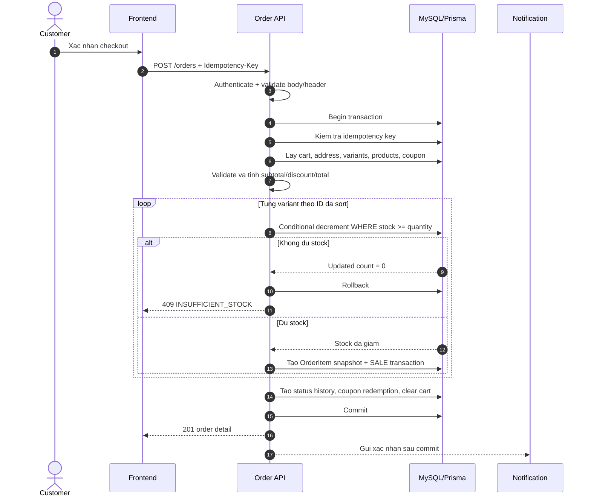
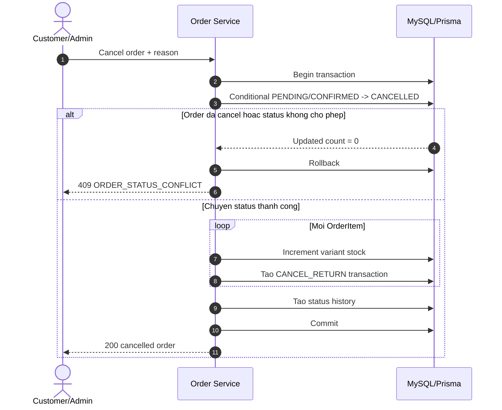

# PHASE 2 - ORDER AND INVENTORY FLOW

## 1. Muc Tieu

Day la flow quan trong nhat cua he thong. Thiet ke phai dam bao:

- Khong ban vuot ton kho khi co nhieu checkout dong thoi.
- Khong tao order nua chung khi mot item loi.
- Gia va thong tin san pham trong order khong thay doi theo catalog sau nay.
- Moi bien dong stock co audit transaction.
- Cancel order chi hoan stock mot lan.
- Retry request khong tao trung order.

## 2. Order Status

Trang thai order da chot:

```text
PENDING -> CONFIRMED -> SHIPPING -> DELIVERED
    |          |
    +----------+------> CANCELLED
```

Ma tran transition:

| Current | Allowed next | Actor | Inventory effect |
|---|---|---|---|
| `PENDING` | `CONFIRMED` | Admin | Khong doi; stock da tru khi checkout |
| `PENDING` | `CANCELLED` | Customer/Admin | Hoan stock mot lan |
| `CONFIRMED` | `SHIPPING` | Admin | Khong doi |
| `CONFIRMED` | `CANCELLED` | Customer/Admin | Hoan stock mot lan |
| `SHIPPING` | `DELIVERED` | Admin | Khong doi |
| `SHIPPING` | `CANCELLED` | Khong cho phep mac dinh | Can quy trinh return rieng sau nay |
| `DELIVERED` | - | - | Terminal; return/refund la module mo rong |
| `CANCELLED` | - | - | Terminal |

Admin khong duoc chuyen nguoc, bo qua buoc, hoac khoi phuc `CANCELLED` bang API status thong thuong.

## 3. Payment Status

Payment status tach khoi order status:

```text
UNPAID -> PAID
UNPAID -> FAILED
PAID -> REFUNDED
```

Giai doan dau ho tro `COD`:

- Tao order: `paymentStatus=UNPAID`.
- Giao thanh cong va thu tien: admin/payment workflow dat `PAID`.
- Order status va payment status khong duoc suy dien tuy tien tu nhau.

Online payment la mo rong; webhook phai co signature validation va idempotency.

## 4. Inventory Transaction Types

| Type | Delta | Nguon | Vi du |
|---|---:|---|---|
| `SALE` | Am | Checkout | `-2`, stock 10 -> 8 |
| `CANCEL_RETURN` | Duong | Cancel order | `+2`, stock 8 -> 10 |
| `IMPORT` | Duong | Admin nhap hang | `+20` |
| `MANUAL_ADJUSTMENT` | Am/duong | Admin dieu chinh | Kiem ke sua 8 -> 7 |
| `RETURN` | Duong | Quy trinh return sau nay | `+1` |

Moi record luu `variantId`, `type`, `quantityDelta`, `stockBefore`, `stockAfter`, `orderId?`, `reference?`, `reason?`, `createdBy?`, `createdAt`.

Bat bien:

```text
stockAfter = stockBefore + quantityDelta
stockAfter >= 0
```

## 5. Checkout Input Va Trust Boundary

Frontend chi gui:

```json
{
  "shippingAddressId": "addr_01J...",
  "couponCode": "RACE10",
  "paymentMethod": "COD",
  "note": "Giao gio hanh chinh"
}
```

Backend tu lay:

- Cart items cua authenticated user.
- Product/variant active status.
- Stock hien tai.
- Product name, SKU, size, color.
- Gia hien tai tu variant/product.
- Coupon rule va usage hien tai.
- Shipping fee theo cau hinh backend.

Frontend khong duoc quyet dinh `unitPrice`, `subtotal`, `discount`, `total`, `stock` hoac `userId`.

## 6. Money Calculation

Tinh trong backend bang decimal:

```text
itemSubtotal = unitPrice * quantity
subtotal = sum(itemSubtotal)
discount = validated coupon result
shippingFee = shipping rule result
grandTotal = max(0, subtotal - discount) + shippingFee
```

Moi `OrderItem` snapshot:

- `productId` va `variantId` de tham chieu neu con.
- `productName`.
- `sku`.
- `size`.
- `color`.
- `unitPrice`.
- `quantity`.
- `subtotal`.
- `imageUrl` tuy chon de hien thi lich su tot hon.

Order snapshot dia chi giao hang va coupon code/discount; khong doc lai address/coupon khi xem order cu.

## 7. Checkout Transaction

Prisma `$transaction` phai bao trum toan bo thao tac thay doi. De tranh oversell, moi variant duoc tru bang conditional atomic update:

```text
UPDATE ProductVariant
SET stock = stock - requestedQuantity
WHERE id = variantId
  AND isActive = true
  AND stock >= requestedQuantity
```

Trong Prisma co the dung `updateMany` voi dieu kien `stock: { gte: quantity }` va `decrement`. Neu `count != 1`, throw `INSUFFICIENT_STOCK`; transaction rollback toan bo.

Khong tach `SELECT stock` va `UPDATE stock` thanh hai thao tac khong co bao ve, vi hai checkout co the cung doc stock cu.

Thu tu transaction de giam deadlock:

1. Sort cart items theo `variantId` on dinh.
2. Validate idempotency key/user.
3. Nap cart, address, variant/product va coupon.
4. Validate tat ca business rule va tinh tong.
5. Tao order o `PENDING`.
6. Voi tung item theo thu tu da sort: conditional decrement stock.
7. Tao OrderItem snapshot.
8. Tao InventoryTransaction `SALE` voi before/after.
9. Tang coupon usage va tao coupon redemption neu co.
10. Xoa cart items.
11. Ghi order status history ban dau.
12. Commit.

Neu bat ky buoc nao loi, throw de Prisma rollback. Email/notification chi gui sau commit, khong nam trong database transaction.

## 8. Checkout Sequence



## 9. Idempotency

`POST /orders` bat buoc `Idempotency-Key` la UUID do frontend tao cho moi lan customer bam dat hang.

Quy tac:

- Unique theo cap `(userId, idempotencyKey)`.
- Luu request hash, order ID, response status va thoi gian tao.
- Cung key + cung request sau khi thanh cong: tra lai order da tao, khong tru stock lan nua.
- Cung key + payload khac: `409 DUPLICATE_REQUEST`.
- Request dang xu ly: tra `409 REQUEST_IN_PROGRESS` hoac cho ngan co timeout.
- Record co the het han sau 24 gio, nhung order relation van unique de audit.

Frontend disable nut khi dang gui van can thiet cho UX, nhung idempotency backend moi la bao ve chinh.

## 10. Coupon Validation Trong Checkout

Backend kiem tra lai:

- Code ton tai va `isActive=true`.
- `startAt <= now <= endAt`.
- Chua vuot global `usageLimit`.
- User chua vuot `perUserLimit`.
- Subtotal dat `minOrderValue`.
- Product/category/brand restriction neu co.
- Gia tri percent/fixed hop le.
- Percent discount khong vuot `maxDiscount`.

Coupon usage/redemption duoc ghi trong cung checkout transaction de hai order dong thoi khong vuot limit. Preview coupon o cart khong duoc coi la reservation.

## 11. Cancel Order Transaction

Cancel order cung la mot transaction atomic:

1. Nap order theo `orderId` va owner/quyen admin.
2. Conditional update order tu status cho phep sang `CANCELLED`.
3. Neu affected count khong bang 1, tra `ORDER_STATUS_CONFLICT`.
4. Voi moi OrderItem, increment stock theo quantity.
5. Tao `InventoryTransaction` type `CANCEL_RETURN`.
6. Ghi `OrderStatusHistory` voi actor, reason.
7. Release/decrement coupon redemption theo policy da chot.
8. Commit.

Conditional status update dam bao hai request cancel dong thoi chi mot request hoan stock.



## 12. Admin Status Update

Service dung transition map trung tam:

```text
PENDING: [CONFIRMED, CANCELLED]
CONFIRMED: [SHIPPING, CANCELLED]
SHIPPING: [DELIVERED]
DELIVERED: []
CANCELLED: []
```

Moi transition:

- Validate current -> target.
- Conditional update theo current status de tranh lost update.
- Ghi `OrderStatusHistory` gom `fromStatus`, `toStatus`, `actorId`, `note`, `createdAt`.
- Neu target `CANCELLED`, goi cung inventory cancellation logic trong transaction.
- Notification sau commit.

## 13. Manual Inventory Adjustment

Endpoint `PATCH /admin/inventory/:variantId` nhan:

```json
{
  "mode": "SET",
  "quantity": 12,
  "reason": "Physical stock count on 2026-10-05"
}
```

Rule:

- `quantity` la so nguyen khong am voi `SET`/`INCREMENT`.
- `DECREMENT` chi thanh cong neu stock du.
- Reason trim, toi thieu 5 ky tu.
- Trong transaction, tinh delta va cap nhat stock co dieu kien.
- Tao `MANUAL_ADJUSTMENT` voi admin actor.
- `SET` cung phai ghi delta that, vi du 10 -> 12 la `+2`.
- Khong cho sua/xoa inventory transaction sau khi tao.

Bulk import tao mot batch reference. Neu yeu cau la atomic import, mot item loi rollback ca batch; giai doan dau chon atomic de de doi soat.

## 14. Low Stock And Availability

- `OUT_OF_STOCK`: stock = 0.
- `LOW_STOCK`: 1 <= stock <= 5.
- `IN_STOCK`: stock > 5.

Day la derived status, khong can luu thanh cot de tranh lech du lieu. Product duoc xem la con hang neu co it nhat mot variant active co stock > 0.

Khong reserve stock khi item nam trong cart. Stock chi duoc tru luc checkout thanh cong. Vi vay cart co the hop le luc them nhung het hang luc checkout; API phai tra ro item nao thieu va stock hien tai.

Vi du error:

```json
{
  "success": false,
  "message": "Some items no longer have enough stock",
  "code": "INSUFFICIENT_STOCK",
  "errors": [
    {
      "field": "items.variant_01J...",
      "message": "Requested 2, available 1",
      "meta": {
        "variantId": "variant_01J...",
        "requested": 2,
        "available": 1
      }
    }
  ],
  "requestId": "req_01J..."
}
```

## 15. Demo Flow Bat Buoc

Flow du an phai tai hien duoc:

1. Variant Ferrari Red/M co stock 10.
2. Customer them quantity 2 vao cart.
3. Customer checkout voi `Idempotency-Key` moi.
4. Transaction tao order va snapshot item.
5. Conditional decrement dua stock 10 -> 8.
6. Inventory history co `SALE`, delta `-2`, before 10, after 8, lien ket order.
7. Admin thay order `PENDING`.
8. Admin chuyen `PENDING -> CONFIRMED -> SHIPPING -> DELIVERED`.
9. Dashboard revenue tinh order sau khi `DELIVERED`.

Flow cancel de test doi ung:

1. Checkout lam stock 10 -> 8.
2. Cancel order o `PENDING` hoac `CONFIRMED`.
3. Stock 8 -> 10.
4. Chi co mot `CANCEL_RETURN +2` cho order item.
5. Retry cancel tra conflict/idempotent response nhung khong hoan stock lan hai.

## 16. Failure Handling

| Failure | Ket qua bat buoc |
|---|---|
| Mot variant khong du stock | Rollback ca order, khong item nao bi tru |
| Coupon het han giua preview va checkout | Khong tao order, tra `COUPON_INVALID` |
| Tao inventory log loi | Rollback stock va order |
| Clear cart loi | Rollback checkout |
| Notification loi sau commit | Order van thanh cong; retry notification rieng |
| Client timeout sau commit | Retry cung idempotency key tra order cu |
| Hai checkout tranh stock cuoi | Chi conditional update thanh cong duoc tao order |
| Hai cancel dong thoi | Chi transition dau hoan stock |
| Admin sua stock va checkout dong thoi | Atomic update bao dam stock khong am |

## 17. Transaction Isolation Va Retry

- Bat dau voi MySQL `READ COMMITTED` hoac isolation mac dinh, nhung dua vao conditional writes va unique constraints cho correctness.
- Transaction ngan, khong upload file/gui email/goi payment provider ben trong.
- Sort variant IDs truoc update de giam deadlock.
- Bat Prisma error/deadlock co the retry toan transaction toi da 2-3 lan voi jitter.
- Khong retry validation/business errors.
- Unique constraint cho idempotency, SKU va coupon redemption la lop bao ve cuoi.

## 18. Audit And Observability

Moi request thay doi order/inventory co:

- `requestId` trong log va error response.
- `actorId` va actor role neu dang nhap.
- `orderId`, `variantId`, transaction type.
- Khong log address day du, token hoac payment secret.
- Metric: checkout success/failure, insufficient stock, cancellation, low-stock count.

InventoryTransaction va OrderStatusHistory la audit record bat bien. Sua sai duoc thuc hien bang transaction dieu chinh moi, khong rewrite lich su.

## 19. Test Cases Bat Buoc Cho Phase 14

- Checkout mot item thanh cong va snapshot dung gia.
- Checkout nhieu item thanh cong.
- Cart rong bi reject.
- Variant inactive/product inactive bi reject.
- Quantity lon hon stock bi reject va rollback toan bo.
- Hai checkout tranh stock cuoi chi mot thanh cong.
- Coupon hop le, het han, inactive, qua usage limit, khong dat min value.
- Retry cung idempotency key khong tao order moi.
- Cung key khac payload bi reject.
- Customer khong xem/huy order cua user khac.
- Transition order hop le va khong hop le.
- Cancel hoan stock va tao `CANCEL_RETURN`.
- Cancel hai lan khong tang stock hai lan.
- Manual decrement khong lam stock am.
- Import va adjustment deu co audit log.
- Dashboard khong tinh revenue cua order chua delivered.

## 20. Diem Chot Cho Phase 3

Database design phai co du constraint/relationship cho:

- Order va OrderItem snapshot.
- OrderStatusHistory.
- ProductVariant stock va unique SKU/combination.
- InventoryTransaction bat bien.
- Coupon redemption/usage theo user.
- Idempotency record unique theo user/key.
- Refresh session va token family.
- Decimal money va index phuc vu order/inventory query.

Nhung entity va constraint nay se duoc mo ta chinh xac trong `docs/ERD.md` o Phase 3.
